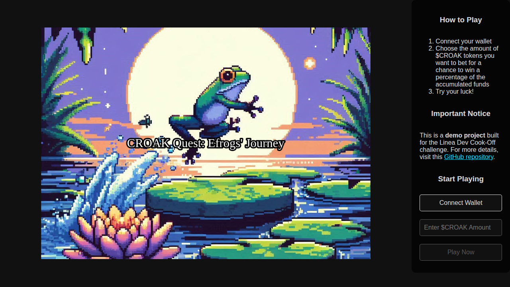

# 🐸 CROAK Quest: Efrogs' Journey

CROAK Quest: Efrogs' Journey is a blockchain-powered game that combines the charm of classic arcade games with the excitement of Web3 technology.

## Live Demo

[Play CROAK Quest on Linea Mainnet](https://username-anthony-is-not-available.github.io/CROAK-Quest-Efrogs-Journey/)

[View the Smart Contract on Linea Mainnet](https://lineascan.build/address/0xae685dbbf74a5684d25ee24d00ff33ac38b7b362)

### ⚠️ Important Notice

This is a **demo project** built for the Linea Dev Cook-Off challenge. While fully playable on the Linea mainnet, please note:

- Linea transaction fees are low, and $CROAK tokens have minimal value.
- **Do not bet more than a few cents worth of tokens, as you may lose them.**

## Key Features

- **Blockchain Integration**: Connect your crypto wallet to play and verify Efrogs NFT ownership.
- **$CROAK Betting System**: Use $CROAK tokens to power up your frog's jumps.
- **Efrogs NFT Ownership**: Personalize your in-game frog with your Efrogs NFT.
- **Charming Visuals**: Enjoy ~~vibrant graphics~~ poorly drawn pixel art that bring the pond and its inhabitants to life.

## Tamper-Proof Randomness (Chainlink VRF)

To eliminate the security risks of on-chain pseudo-randomness (e.g. validator manipulation or attacker contracts conditionally reverting losing bets in the same block), CROAK Quest uses Chainlink VRF (Verifiable Random Function) in a two-step betting architecture:

1. **Request Phase (`bet`)**: When a player places a bet, tokens are transferred to the contract and a request is dispatched to the VRF Coordinator via `requestRandomWords`. A `BetRequested(requestId, player, amount)` event is emitted and stored in `s_requests`. The outcome is intentionally not resolved in this transaction, preventing smart contract attackers from querying or conditionally reverting outcomes in the same block.
2. **Fulfillment Phase (`fulfillRandomWords`)**: In a subsequent block, the off-chain VRF oracle executes `rawFulfillRandomWords` through the VRF Coordinator with verifiable random words. The contract determines the win outcome, distributes payouts or accrues house funds, and emits a `Bet(player, amount, won, nftBonus)` event.

## House Rules & Betting Limits

To ensure contract solvency and prevent payout transaction reverts due to insufficient house liquidity, individual bet sizes are capped dynamically relative to the contract's accumulated pool:

- **Maximum Bet Sizing Formula**:
  $$\text{Max Bet Amount} = \frac{\text{Accumulated Funds} \times \text{Max Bet Percentage}}{100}$$
- **Default Cap**: 5% of accumulated house funds (configurable by contract owner between 1% and 25%).
- **Dynamic Scaling**: The maximum bet limit scales automatically as liquidity is added or accumulated through gameplay. Any attempt to bet beyond the dynamic limit reverts on-chain with `BetExceedsMaxLiquidity(amount, maxBet)`.

## Disconnection Recovery & Pending Transactions

To protect players on fluctuating networks or mobile devices against lost state during page reloads, pending transaction hashes are stored in `localStorage` under `croak_quest_pending_tx` as soon as broadcast on-chain:

- **Automatic Recovery**: On reconnect or page refresh, `WalletManager.recoverPendingTransaction()` queries `provider.getTransactionReceipt(txHash)`. If mined, it decodes the on-chain `Bet` event, updates player state and balances, and notifies the player with their outcome.
- **Expiration TTL**: Stale pending transactions automatically expire and clear after 30 minutes to ensure stale entries do not linger indefinitely.

## Emergency Stop Mechanism (Pausable)

To protect user funds and contract liquidity in an emergency, the contract incorporates OpenZeppelin's standardized `Pausable` module:

- **Betting Guard**: The `bet(uint256)` function is protected with the `whenNotPaused` modifier. If the contract is paused, calling `bet` reverts with `EnforcedPause()`.
- **Administrative Functions**:
  - `pause()`: Callable only by the contract owner (`onlyOwner`) to freeze betting during suspected exploits, maintenance, or migration periods. Emits a `Paused(address account)` event.
  - `unpause()`: Callable only by the contract owner (`onlyOwner`) to resume normal betting operations. Emits an `Unpaused(address account)` event.
- **Withdrawal Safety**: Administrative functions such as `removeFunds(uint256)` remain unpaused so owner recovery capabilities and house fund extractions are never locked even during an active pause state.

## Technology Stack

- Phaser 3
- React
- Vite
- Hardhat
- Solidity

This project is built upon the Phaser 3 React Template. For more details, refer to the [official GitHub repository](https://github.com/phaserjs/template-react).

## Getting Started

### Prerequisites

- [Git](https://git-scm.com/) to clone the repository.
- [Node.js and npm](https://nodejs.org/) to install dependencies and run the project scripts. `package.json` does not declare a required Node.js version.

### Install and run locally

From a terminal, clone the repository and install dependencies:

```sh
git clone https://github.com/username-anthony-is-not-available/CROAK-Quest-Efrogs-Journey.git
cd CROAK-Quest-Efrogs-Journey
npm install
```

Start the Vite development server:

```sh
npm run dev
```

The development server uses port `8080` by default. Open [http://localhost:8080](http://localhost:8080); if the port is already occupied, use the address printed in the terminal.

### Build and verification commands

Run the checks from the repository root after installing dependencies:

| Command | Purpose |
| --- | --- |
| `npm run typecheck` | Run TypeScript checking without emitting files. |
| `npm test` | Run the Hardhat tests listed in `package.json`. |
| `npm run test:e2e` | Run the Playwright end-to-end tests. |
| `npm run build` | Create the production Vite bundle in `dist/`. |
| `npm run clean-build` | Remove the `build/` deployment directory. |
| `npm run build-and-copy` | Clean `build/`, build into `dist/`, then copy the distribution files into `build/`. |

### Deploy the web app to GitHub Pages

`npm run deploy` publishes the contents of `build/` using `gh-pages`. npm first runs the `predeploy` script automatically; that script calls `build-and-copy`, which clears the old `build/`, creates the production bundle in `dist/`, and copies it into `build/`. Run this only from a checkout with permission to publish to the repository, because it updates the GitHub Pages deployment.

On Windows, the current `copy-dist-to-build` script uses `xcopy` and `npm run deploy` can be used as written. On Linux and macOS, that script is Windows-specific. Before deploying, replace its value in `package.json` with the platform's `cp` command:

```json
"copy-dist-to-build": "cp -r dist build"
```

Then run `npm run deploy`. The command deploys the web app; it does not deploy or modify the smart contract.

## Screenshot



## Watch the video

https://github.com/username-anthony-is-not-available/CROAK-Quest-Efrogs-Journey/victory_demo.mp4

## Contributing

Contributions are welcome! Please feel free to submit a Pull Request.

## Autonomous Management

This repository is initialized for autonomous management by the Intelligent Project Manager (IPM), Jules.

### Role of Jules
- **Monitor**: Jules tracks the project's progress by referencing `BACKLOG.md`.
- **Execute**: Jules implements new features, fixes bugs, and improves documentation according to the tasks defined in the backlog.
- **Enforce Standards**: All work performed by Jules must adhere to the guidelines specified in `STANDARDS.md`.

### Operational Instructions
- **Backlog**: Refer to `BACKLOG.md` for current milestones and tasks.
- **Standards**: Refer to `STANDARDS.md` for development and quality guidelines.
- **Testing**: Ensure all tests pass by running `npm run test` before submitting changes.

## License

This project is licensed under the [MIT License](LICENSE).
